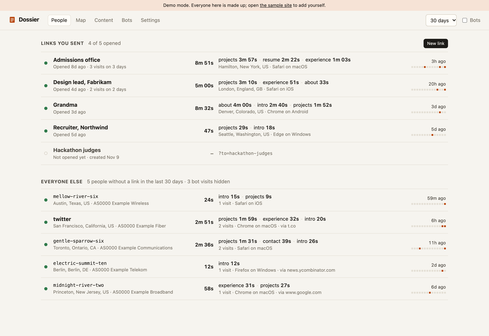
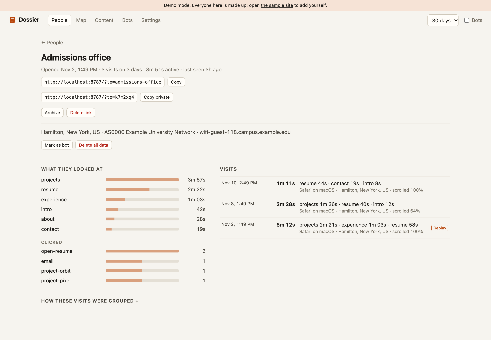
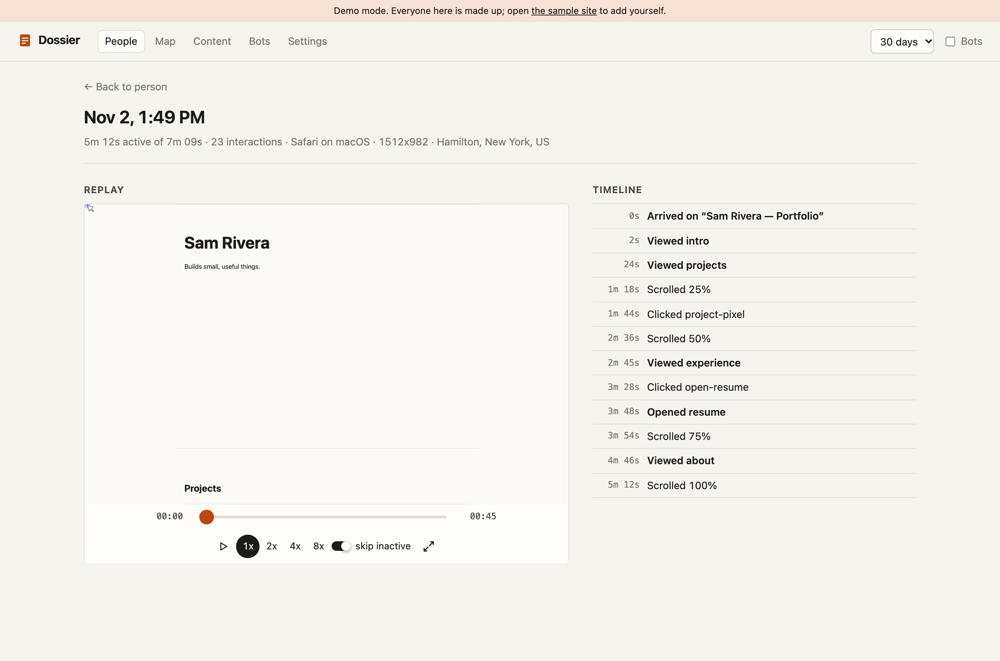
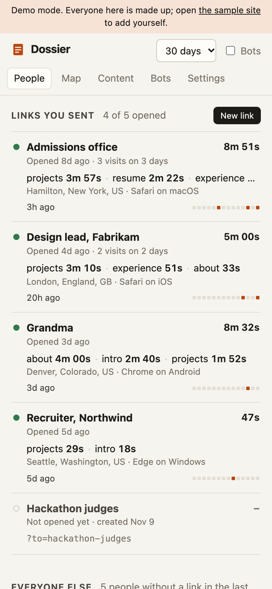
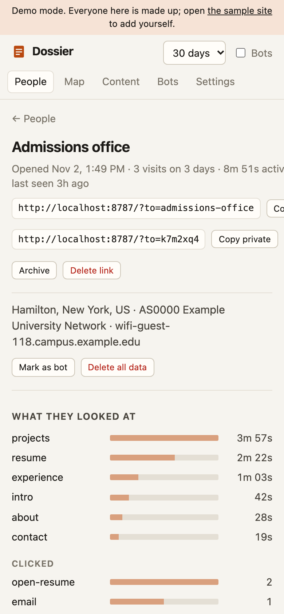

# Dossier

**Did the person you sent it to actually look?**

Dossier is self-hosted analytics for when you're waiting on a handful of specific people. You sent your portfolio to an admissions office, a recruiter and your grandma. Dossier tells you which of them opened it, when, for how long, what they spent their time on, and whether they came back two days later.

I built it for my own [interactive resume](https://github.com/trevor050/colgate-room-portfolio), because "12 visitors this week" is useless when the only question you have is *"did Colgate look?"*



## How it works

1. **You make a link per person.** In the dashboard, "New link" → `Admissions office` gives you `yoursite.com/?to=admissions-office` (or `?to=k7m2xq4` if you'd rather the URL not say who it's for). The tag is removed from their address bar as soon as the page loads.
2. **They open it.** A small first-party script (13 KB) records the visit: which sections were on screen while they were actually active, clicks, scroll depth, and optionally a session replay.
3. **You check the dashboard**, probably from your phone, probably more often than is healthy. Each link shows opened or not, first and last visit, active time, top sections, and a little 14-day strip of the days they came back.

Visits without a link still show up under "Everyone else", grouped into people by browser storage, an optional fingerprint, and IP + browser matches. That's a decent guess, and the dashboard says so. The named link is the part you can trust.

| A person | A visit, with replay |
| --- | --- |
|  |  |

It also has a map (an inline SVG, no tile servers), a content view for "which sections get attention across everyone", a bot review page, and retention settings. It's built to be read on a phone:

<p>
  
  
</p>

## Try it without setting anything up

```bash
git clone https://github.com/trevor050/dossier && cd dossier
npm install
npm run demo
```

That runs the real dashboard on an in-memory Postgres ([PGlite](https://pglite.dev)) full of invented people, at `http://localhost:8787/api/admin`. It also serves a sample site at `http://localhost:8787/`; click around it (try `/?to=whoever`) and you'll show up in the dashboard a few seconds later, replay included.

## Set it up for real (about ten minutes)

You need a Postgres database. [Neon](https://neon.tech) and [Supabase](https://supabase.com) both have free tiers that are plenty for this; anything that speaks Postgres works.

**1. Install and scaffold** (in the project you deploy to Vercel):

```bash
npm install @trevor050/dossier
npx dossier init
```

> Not on npm yet. Until it is: `npm install github:trevor050/dossier`

`init` adds two files, `api/collect.ts` and `api/admin.ts`, each a one-line re-export. Two Vercel Functions total, so it fits the Hobby plan.

**2. Set two environment variables** in Vercel, and in a local `.env` for the next step:

```bash
DATABASE_URL=postgres://...
DOSSIER_ADMIN_TOKEN=...   # at least 16 characters; `npx dossier token` makes one
```

**3. Create the tables:**

```bash
npx dossier migrate
```

**4. Add the snippet** to your site:

```html
<script defer src="/api/collect"></script>
```

Or from a bundled app:

```ts
import { initDossier } from '@trevor050/dossier/client';

const dossier = initDossier({ ignore: () => import.meta.env.DEV });
```

**5. Deploy, open `/api/admin`, sign in, make your links.**

Not on Vercel? `npx dossier serve` runs the same collector and dashboard as a plain Node server; put it behind your reverse proxy (with `--trust-proxy`). Details, options and troubleshooting are in [docs/setup.md](docs/setup.md).

## Telling it what to measure

Time is attributed to whatever is on screen while the visitor is present (tab visible, some sign of life in the last 30 seconds):

```html
<section id="projects">…</section>          <!-- any section with an id -->
<div data-section="resume">…</div>          <!-- or name it explicitly -->
<button data-track="download-resume">…</button>  <!-- clicks and hovers -->
```

For things that aren't scrollable DOM, like modals or a canvas scene, tell it directly:

```ts
dossier.enter('resume-overlay'); // time now counts toward "resume-overlay"
dossier.leave('resume-overlay');
dossier.track('download_resume', { format: 'pdf' });
```

Session replay is off unless you ask for it: `data-replay="0.25"` on the script tag, or `initDossier({ replay: 0.25 })` to record a quarter of sessions. All client options are in [docs/setup.md](docs/setup.md#client-options).

## Privacy, honestly

Dossier is **first-party and self-hosted**: the script is served from your domain, data goes to your database, and nothing is sent to a third party unless you turn on IP enrichment. There's no ad network, no cross-site tracking, no data sharing.

It is **not anonymous** and doesn't pretend to be. Its whole job is to tell you that a specific person opened a specific link. It stores IP addresses and user agents, can record session replays, and groups visits into people. If you use it, the people you send links to should be able to find out that you do. You are the operator, so disclosure and compliance with whatever applies to you (GDPR, CCPA, your school's policies, etc.) are your responsibility. This README is not legal advice.

What it gives you to be decent about it:

- **Global Privacy Control and Do Not Track are honored by default.** Browsers sending either are not tracked at all. (Brave sends GPC by default, so expect to miss some Brave users. That's the point.)
- **Opt-out link.** Anyone can visit `yoursite.com/?dossier=off` to stop being tracked in that browser, permanently. `?dossier=on` undoes it. Handy for excluding yourself too.
- **Replay masks every input by default**, plus anything marked `data-dossier-mask`; `data-dossier-block` elements aren't recorded at all.
- **Fingerprinting is off by default.** Turn it on with `fingerprint: true` if you want visits linked across cleared storage.
- **Retention**: human visits 365 days, bot visits 30, replays 30 by default; change them in Settings. Expired data is deleted automatically.
- **Delete a person**: one button removes them and everything derived from them, including IP lookups and identity links.

The full list of what's collected, where it's stored and who else sees it is in [docs/privacy.md](docs/privacy.md).

## IP enrichment (optional)

Off-Vercel, or for network names ("Example University", "Comcast"), Dossier can look up visitor IPs. Every provider is opt-in, cached for 30 days, and skipped for obvious bots:

| Provider | Turn on with | Free tier (checked Nov 2026) | You get |
| --- | --- | --- | --- |
| Vercel geo headers | nothing, automatic on Vercel | included | city, region, country, coordinates |
| [IPinfo Lite](https://ipinfo.io/lite) | `IPINFO_TOKEN` | free, unlimited requests | country and network (ASN) only |
| IPinfo paid plans | `IPINFO_TOKEN` + `IPINFO_API=standard` | paid | city, coordinates, organization |
| [ipwho.is](https://ipwhois.io/documentation) | `DOSSIER_IPWHOIS=1` | 1,000 requests/day per client IP | city, coordinates, ISP |
| Reverse DNS | on by default, `DOSSIER_PTR=0` to disable | your DNS resolver | hostnames like `*.campus.example.edu` |

With all of it off, everything still works; you just see less about where people were.

## Architecture

```
your site ──<script src=/api/collect>──▶ GET  /api/collect   tracker script, lazy replay/fingerprint chunks
          ──events, summaries────────▶ POST /api/collect   validate → bot score → enrich → Postgres
          ──replay chunks────────────▶ POST /api/collect?kind=replay
you ──────────────────────────────────▶      /api/admin     dashboard (Preact, bundled in) + JSON API
```

- **`src/client`** is the tracker: an activity clock (active vs idle vs hidden), section dwell, link capture, privacy switches. No runtime dependencies; rrweb and FingerprintJS are fetched from the collector only when enabled.
- **`src/server`** has two Web-standard `Request → Response` handlers. Vercel runs them via `export default { fetch }`; `src/server/node.ts` adapts them for plain Node.
- **Identity** (`src/server/identity.ts`): every request adds weighted, time-decaying edges between the visitor id, session cookie, optional fingerprint and IP + user agent (never IP alone). A chain of evidence is only as strong as its links (product), and independent shared signals add up (noisy-or). Visitors above 0.5 confidence are grouped. See [docs/identity.md](docs/identity.md).
- **Bots** (`src/server/bot.ts`): additive score from the user agent, `navigator.webdriver`, missing Accept-Language, datacenter networks, request velocity and zero-interaction sessions. Bots are kept out of People, the map and the identity graph, and you can override either way.
- **Postgres** with versioned migrations (`npx dossier migrate`). Demo mode and the tests use PGlite, so the same SQL runs everywhere.

## Development

```bash
npm install
npm run build        # bundles the tracker and dashboard, then compiles TypeScript
npm test             # unit + integration tests against PGlite
npm run typecheck
npm run demo         # dashboard on fake data at localhost:8787
```

`node scripts/e2e.mjs` drives a real Chromium through the sample site and checks the result through the admin API (needs `npm run demo` or `dossier serve --sample` running). `node scripts/screenshots.mjs` regenerates the images above from the demo.

## License

MIT
